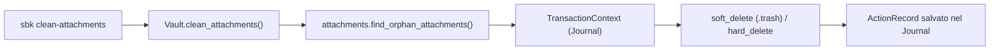
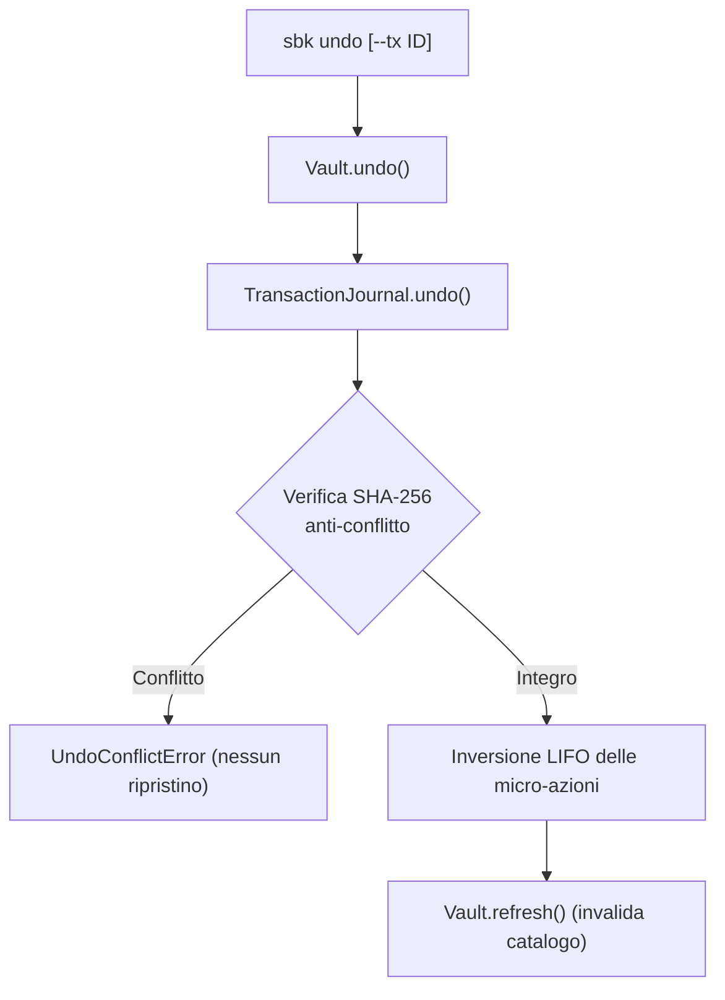
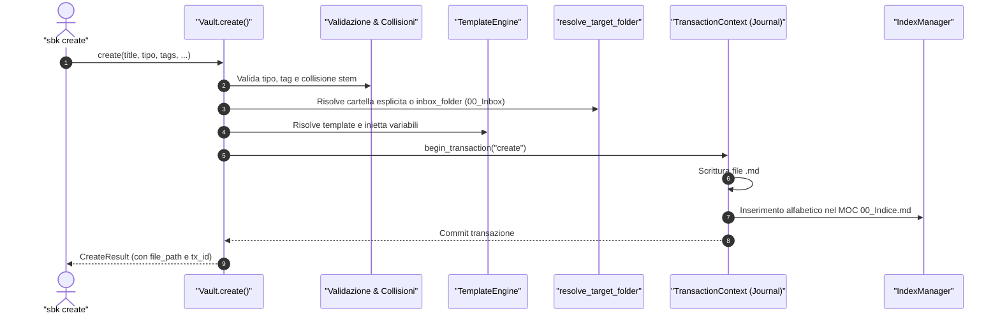

# Manuale di Riferimento dei Comandi CLI (`sbk` / `vk`)

Questo documento fornisce la specifica tecnica completa per ciascuno dei **20 comandi** esposti dalla CLI di `second-brain-keeper`. 
Per ciascun comando sono descritti: la finalità operativa, la sintassi completa, l'interazione con le classi interne del sistema, i codici di uscita ed esempi pratici di utilizzo.

> [!NOTE] Diagnostica Consolidata
> I precedenti comandi `check-links` e `disambiguate` sono stati integrati direttamente nella **Fase 5 di `sbk audit`** (Referential Integrity e Collisioni di Stem), eliminando la frammentazione e offrendo un quadro diagnostico unificato.

---

## 1. `sbk init`

Inizializza un file di configurazione predefinito `vault.toml` all'interno della cartella specificata o nella radice del Vault.

### Sintassi
```bash
sbk init [--target DIRECTORY] [--force]
```
- `--target DIRECTORY`: Cartella in cui generare `vault.toml` (default: directory corrente o radice del Vault).
- `--force`: Sovrascrive il file se già presente.

### Interazione Architetturale
`handle_init()` $\rightarrow$ Genera il template TOML standard basato sui campi di [`VaultConfig`](../architecture/models.md#vaultconfig) con commenti descrittivi.

### Codici di Uscita
- `0 (SUCCESS)`: File generato con successo.
- `1 (ERROR)`: File già esistente (senza `--force`) o errore di I/O.

### Esempio
```bash
sbk init --target /srv/storage/Vault --force
```

---

## 2. `sbk audit`

Esegue la suite diagnostica in 5 fasi del Second Brain, individua violazioni di governance e calcola il punteggio ponderato *Vault Health Score* (0.0 - 100.0).

### Sintassi
```bash
sbk audit [--target PATH] [--step {1,2,3,4,5}] [-f {md,json,yaml}] [-o FILE] [--json FILE] [--report-md FILE]
```
- `--target PATH`: Circoscrive l'analisi a un singolo file `.md` o a una sottocartella specifica.
- `--step {1..5}`: Esegue esclusivamente la fase diagnostica indicata:
  - `1`: Storage & Filesystem (lunghezza percorsi, estensioni permesse, file pesanti).
  - `2`: Naming Conventions (conformità Title_Case).
  - `3`: Frontmatter & Types (blocco YAML, campi obbligatori, tipologia autorizzata).
  - `4`: Tag Taxonomy (verifica contro vocabolario controllato `00_Tassonomia_Tag.md`).
  - `5`: Referential Integrity (wikilink rotti, embed orfani, collisioni di stem omonimi tra cartelle).
- `-f, --format {md,json,yaml}`: Formato di output per la console (default: `md`).
- `-o, --output FILE`: Esporta il referto a file (formato dedotto dall'estensione `.md`, `.json`, `.yaml`). L'opzione è cumulabile più volte per generare simultaneamente referti multipli.
- `--json FILE`: Salva il referto diagnostico completo in formato JSON.
- `--report-md FILE`: Salva un rapporto analitico formattato in Markdown per Obsidian.

### Interazione Architetturale
`handle_audit()` $\rightarrow$ [`Vault.audit()`](../architecture/facade.md) $\rightarrow$ `run_audit()` in `audit.py` $\rightarrow$ Restituisce [`AuditReport`](../architecture/models.md#auditreport).

### Codici di Uscita
- `0 (SUCCESS)`: Health Score pari a 100.0 e zero problematiche riscontrate.
- `2 (ISSUES_FOUND)`: Esecuzione completata ma sono state riscontrate problematiche o avvisi.

### Esempi
```bash
# Esecuzione completa con output a terminale
sbk audit

# Scansione circoscritta all'area progetti con export simultaneo in Markdown e JSON
sbk audit --target 10-19_Progetti -o report.md -o report.json

# Esecuzione della sola fase 3 (Frontmatter)
sbk audit --step 3
```

---

## 3. `sbk clean-attachments`

Ispeziona le cartelle dedicate agli allegati (`_attachments`, `media`, `90-99_Allegati`, ecc.) e bonifica i file binari che non risultano citati in alcuna nota del Vault.

### Sintassi
```bash
sbk clean-attachments [--target PATH] [--dry-run] [--hard-delete]
```
- `--target PATH`: Cartella specifica in cui cercare allegati orfani.
- `--dry-run`: Mostra l'elenco dei file orfani senza apportare modifiche su disco.
- `--hard-delete`: Elimina fisicamente i file invece di spostarli nella directory reversibile `.trash/`.

### Interazione Architetturale


### Reversibilità
**Completamente reversibile tramite `sbk undo`** (sia in caso di soft-delete che di hard-delete su file di testo).

### Codici di Uscita
- `0 (SUCCESS)`: Bonifica o simulazione completata.
- `1 (ERROR)`: Errore di filesystem o percorso inesistente.

### Esempio
```bash
# Anteprima sicura
sbk clean-attachments --dry-run

# Bonifica effettiva con soft-delete reversibile
sbk clean-attachments
```

---

## 4. `sbk normalize-names`

Normalizza ricorsivamente tutti i nomi di file secondo la convenzione `Title_Case_Con_Underscore`, preservando i prefissi numerici Johnny.Decimal (es. `10-19_`) e gli acronimi protetti (`AI`, `CRM`, `BCG`). **Tutti i wikilink interni in ingresso e gli indici MOC di cartella vengono contestualmente sincronizzati nell'intero Vault**.

### Sintassi
```bash
sbk normalize-names [--target DIR] [--dry-run]
```
- `--target DIR`: Circoscrive l'operazione a una sottocartella specifica.
- `--dry-run`: Anteprima dettagliata dei file che verrebbero rinominati e del numero di backlink da aggiornare.

### Interazione Architetturale
`handle_naming()` $\rightarrow$ [`Vault.normalize_names()`](../architecture/facade.md) $\rightarrow$ `batch_normalize()` in `naming.py` con registrazione automatica nel Journal.

### Reversibilità
**Completamente reversibile tramite `sbk undo`**. L'undo ripristina sia i vecchi nomi sia tutti i wikilink riscritti.

### Esempio
```bash
sbk normalize-names --target 10-19_Progetti/ --dry-run
```

---

## 5. `sbk generate-indices`

Genera o risincronizza i file MOC (`00_Indice.md` o `00_Indice_<Cartella>.md`) aggregando le note per tipologia con abstract estratti da frontmatter, callout o primi paragrafi.

### Sintassi
```bash
sbk generate-indices [--target DIR] [--all] [--dry-run]
```
- `--target DIR`: Cartella specifica in cui aggiornare l'indice.
- `--all`: Propaga ricorsivamente la generazione a tutte le sottocartelle dell'albero decimale.
- `--dry-run`: Mostra il contenuto generato senza salvarlo su disco.

### Interazione Architetturale
`handle_indices()` $\rightarrow$ [`Vault.generate_indices()`](../architecture/facade.md) $\rightarrow$ `IndexManager.rebuild_index()` in `indices.py`.

### Esempio
```bash
sbk generate-indices --target 20-29_Istruzione/ --all
```

---

## 6. `sbk frontmatter`

Sottocomando per l'ispezione e la manipolazione controllata dei metadati YAML conformemente alla governance del Vault.

### Sottocomandi Esposti
1. **`set-type`**: Imposta o aggiorna il campo tipologico (`tipo`).
   ```bash
   # Singola nota
   sbk frontmatter set-type --target NOTA.md --type Appunto [--dry-run]

   # Esecuzione batch da file JSON ({nota: tipo})
   sbk frontmatter set-type --batch batch_types.json [--dry-run]
   ```
2. **`add-tags`**: Inietta uno o più tag nel frontmatter.
   ```bash
   # Singola nota
   sbk frontmatter add-tags --target NOTA.md --tags tech/python area/dev [--overwrite] [--dry-run]

   # Esecuzione batch da file JSON ({nota: [tag1, tag2]})
   sbk frontmatter add-tags --batch batch_tags.json [--overwrite] [--dry-run]
   ```
   - `--overwrite`: Sostituisce i tag esistenti invece di accodarli.
3. **`sanitize-tags`**: Riscrive i tag obsoleti mappandoli secondo le regole di `config.tag_replacements`.
   ```bash
   sbk frontmatter sanitize-tags [--target DIR] [--dry-run]
   ```

I template JSON di riferimento per le operazioni batch sono disponibili in [`examples/batch/`](../../examples/batch/).

### Reversibilità
Tutte le modifiche al frontmatter sono incapsulate in transazioni e **reversibili tramite `sbk undo`**.

---

## 7. `sbk history`

Interroga lo storico delle transazioni atomiche registrate nel Journal in `.sbk/history/*.json.gz`.

### Sintassi
```bash
sbk history [--limit N] [--format {md,json,yaml,csv}] [-o FILE]
```
- `--limit N`: Numero massimo di transazioni da estrarre (default: 20).
- `--format`: Formato di rendering tabellare o serializzato (default: `md`).
- `-o, --output FILE`: Esporta la cronologia su uno o più file (cumulabile).

### Interazione Architetturale
`handle_history()` $\rightarrow$ [`Vault.history()`](../architecture/facade.md) $\rightarrow$ `TransactionJournal.list_transactions()`.

### Esempio
```bash
sbk history --limit 10 --format md -o cronologia.md
```

---

## 8. `sbk undo`

Annulla una transazione completata ripristinando integralmente lo stato del filesystem e del contenuto testuale, previa verifica crittografica SHA-256 anti-conflitto.

### Sintassi
```bash
sbk undo [--tx ID_TRANSAZIONE] [--dry-run]
```
- `--tx ID_TRANSAZIONE`: Identificativo specifico (es. `tx_20261108_143015_...`). Se omesso, annulla **l'ultima transazione attiva non ancora revertita**.
- `--dry-run`: Verifica la fattibilità del rollback e gli hash SHA-256 senza toccare i file.

### Interazione Architetturale


### Esempio
```bash
# Anteprima sicura del rollback
sbk undo --dry-run

# Esecuzione effettiva
sbk undo
```

---

## 9. `sbk redo`

Riapplica l'ultima transazione annullata tramite `sbk undo` (o una specifica transazione indicata tramite `--tx`), ripristinando le modifiche precedentemente disfattesi.

### Sintassi
```bash
sbk redo [--tx ID_TRANSAZIONE] [--dry-run]
```
- `--tx ID_TRANSAZIONE`: Identificativo specifico della transazione revertita da riapplicare. Se omesso, riapplica **l'ultima transazione revertita**.
- `--dry-run`: Verifica la fattibilità della riapplicazione senza modificare i file.

### Interazione Architetturale
`handle_redo()` $\rightarrow$ [`Vault.redo()`](../architecture/facade.md) $\rightarrow$ `TransactionJournal.redo()`.

### Esempio
```bash
# Anteprima della riapplicazione
sbk redo --dry-run

# Riapplicazione effettiva
sbk redo
```

---

## 10. `sbk rename`

Rinomina un file o un appunto Markdown garantendo la normalizzazione dello stem, il pre-flight check sulle collisioni, l'aggiornamento simultaneo di tutti i wikilink in ingresso nel Vault e la sincronizzazione del MOC di cartella. Supporta sia la rinomina singola che l'elaborazione batch atomica da mapping JSON.

### Sintassi
```bash
# Rinomina singola
sbk rename FILE NUOVO_NOME [--skip-links] [--dry-run]

# Rinomina batch da file JSON ({vecchio_percorso: nuovo_nome})
sbk rename --batch mapping.json [--skip-links] [--dry-run]
```
- `FILE`: Percorso del file da rinominare (opzionale se `--batch` specificato).
- `NUOVO_NOME`: Nuovo nome o stem (con o senza estensione `.md`).
- `--batch`: Percorso al file JSON contenente il dizionario di rinomina `{vecchio_percorso: nuovo_nome}`.
- `--skip-links`: Rinomina solo il file fisico saltando la riscrittura dei wikilink nel Vault.
- `--dry-run`: Simula l'operazione visualizzando i link che verrebbero aggiornati.

### Interazione Architetturale
`handle_rename()` $\rightarrow$ [`Vault.rename()`](../architecture/facade.md) o [`Vault.batch_rename()`](../architecture/facade.md).

### Esempi
```bash
# Singola nota
sbk rename 10-19_Progetti/vecchio_progetto.md Progetto_Varys --dry-run

# Batch da file JSON
sbk rename --batch examples/batch/batch_rename_template.json
```

---

## 11. `sbk move`

Sposta una o più note in una directory decimale differente, aggiornando sia l'indice MOC della cartella di origine che quello della cartella di arrivo. Supporta sia lo spostamento singolo che l'elaborazione batch atomica da mapping JSON con validazione Strict All-or-Nothing.

### Sintassi
```bash
# Spostamento singolo
sbk move BERSAGLIO DESTINAZIONE [--dry-run]

# Spostamento batch da file JSON ({sorgente: cartella_destinazione})
sbk move --batch mapping.json [--dry-run]
```
- `BERSAGLIO`: File o directory da spostare (opzionale se `--batch` specificato).
- `DESTINAZIONE`: Cartella di arrivo.
- `--batch`: Percorso al file JSON contenente il mapping `{sorgente: cartella_destinazione}`.
- `--dry-run`: Anteprima dello spostamento.

### Reversibilità
**Reversibile al 100% con un singolo `sbk undo`** sia per operazioni singole che batch.

### Esempi
```bash
# Singolo file
sbk move 00_Inbox/Architettura.md 10-19_Progetti/

# Batch da file JSON
sbk move --batch examples/batch/batch_move_template.json
```

---

## 12. `sbk archive`

Trasferisce un progetto o una risorsa conclusa verso il Cold Storage (`/srv/storage/Archive`). Crea opzionalmente una scheda tombstone nel Vault originario contenente un estratto sintetico e un puntamento storico all'archivio.

### Sintassi
```bash
sbk archive BERSAGLIO [--no-tombstone] [--dry-run]
```
- `BERSAGLIO`: File o cartella da archiviare.
- `--no-tombstone`: Non deposita la nota tombstone nel Vault attivo.
- `--dry-run`: Simula l'archiviazione senza muovere file.

### Interazione Architetturale
`handle_archive()` $\rightarrow$ [`Vault.archive()`](../architecture/facade.md) $\rightarrow$ Restituisce [`ArchiveResult`](../architecture/models.md#archiveresult).

### Esempio
```bash
sbk archive 10-19_Progetti/Progetto_Legacy/
```

---

## 13. `sbk offload`

Identifica file binari pesanti (>50MB o target specificato), li sposta nell'archivio a freddo e sostituisce i riferimenti inline con schede di puntamento esterno per alleggerire il Vault.

### Sintassi
```bash
sbk offload [BERSAGLIO] [--dry-run]
```
- `BERSAGLIO`: File o cartella specifica (se omesso, analizza tutti i file del Vault che superano la soglia).
- `--dry-run`: Simula l'offload visualizzando i megabyte risparmiati.

### Esempio
```bash
sbk offload --dry-run
```

---

## 14. `sbk tags`

Gestisce il vocabolario controllato della tassonomia memorizzato in `00_Tassonomia_Tag.md`.

### Sottocomandi
1. **`show`**: Visualizza i tag censiti, filtrabili per stringa di ricerca.
   ```bash
   sbk tags show [--query RICERCA] [--format {md,json,yaml,csv}] [-o FILE]
   ```
2. **`add`**: Inserisce un nuovo tag in ordine alfabetico sotto la sezione desiderata.
   ```bash
   sbk tags add tech/rust [--section "Tecnologia"] [--dry-run]
   ```
3. **`remove`**: Rimuove un tag dalla tassonomia e da tutte le note che lo utilizzano.
   ```bash
   sbk tags remove tech/obsoleto [--force] [--dry-run]
   ```
   - Se il tag è ancora citato in note e non si usa `--force`, l'operazione viene bloccata.

---

## 15. `sbk config`

Ispeziona o aggiorna a caldo le direttive del file di configurazione `vault.toml`.

### Sottocomandi
1. **`show`**: Mostra la configurazione attiva in formato strutturato.
   ```bash
   sbk config show [--format {yaml,json,md}]
   ```
2. **`set`**: Modifica un valore applicando inferenza automatica di tipo (booleani, interi, float, stringhe).
   ```bash
   sbk config set max_path_length 250 [--dry-run]
   ```

---

## 16. `sbk search`

Motore di ricerca full-text combinatorio e semantico su tutto il Vault con supporto multi-export.

### Sintassi
```bash
sbk search [QUERY] [--tag TAG] [--type TIPO] [--links-to STEM] [--folder CARTELLA] [--format {md,json,yaml,csv}] [-o FILE]
```
- `QUERY`: Termine testuale da cercare nel titolo o corpo delle note.
- `--tag`: Filtro per tag (es. `tech/python`).
- `--type`: Filtro per tipologia di nota (es. `Appunto`, `Progetto`).
- `--links-to`: Filtro per note che citano lo stem specificato (ricerca backlink).
- `--folder`: Circoscrive la ricerca a una specifica cartella decimale.
- `-o, --output FILE`: Esporta i risultati della ricerca su uno o più file.

### Esempio
```bash
# Ricerca combinata con export
sbk search --type Progetto --tag ai --links-to ThinkStation -o risultati.json
```

---

## 17. `sbk graph-health`

Esegue l'analisi topologica della rete dei concetti di Obsidian, identificando note centrali (*hubs*), vicoli ciechi (*dead-ends*), note completamente isolate (*true orphans*) e componenti sconnesse.

### Sintassi
```bash
sbk graph-health [--format {md,json,yaml}] [-o FILE]
```
- `-o, --output FILE`: Esporta il referto topologico su uno o più file.

### Esempio
```bash
sbk graph-health --format md -o 00-09_Meta/Grafo_Diagnostica.md
```

---

## 18. `sbk map`

Genera la cartografia quantitativa dell'albero decimale Johnny.Decimal (conteggio note, allegati, megabyte occupati e verifica presenza dei MOC `00_Indice.md`).

### Sintassi
```bash
sbk map [--format {md,json,yaml}] [-o FILE]
```
- `-o, --output FILE`: Salva la mappa in uno o più file (es. appunto Markdown conforme al Vault).

### Esempio
```bash
sbk map --output 00-09_Meta/Mappa_Vault.md
```

---

## 19. `sbk create`

Crea una nuova nota standardizzata applicando validazione preventiva dei metadati, risoluzione del template appropriato, deposito nella cartella specificata (o nella cartella di staging configurata, default `00_Inbox`) e inserimento automatico nel MOC di cartella.

### Sintassi
```bash
sbk create TITOLO --type TIPO [--folder CARTELLA] [--tags TAGS] [--template TEMPLATE] [--dry-run] [--format {md,json,yaml,csv}]
```
- `TITOLO`: Titolo discorsivo dell'appunto (es. `"Architettura Microservizi"`).
- `--type TIPO`: Tipologia obbligatoria (`Appunto`, `Progetto`, `Contatto`, `Risorsa`, `Sistema`).
- `--folder CARTELLA`: Cartella esplicita di destinazione (es. `10-19_Progetti`). Se omessa, la nota viene depositata nell'area di staging (`00_Inbox` o valore impostato in `inbox_folder` nel file `vault.toml`), pronta per essere revisionata o successivamente smistata.
- `--tags TAGS`: Tag separati da virgola (validati preventivamente contro la tassonomia se `strict_taxonomy=True`).
- `--template TEMPLATE`: Nome o percorso di un template personalizzato. Se omesso, seleziona il template predefinito per la tipologia.
- `--dry-run`: Simula la generazione senza scrivere il file né aggiornare l'indice.
- `--format`: Formato di output (`md`, `json`, `yaml`, `csv`).

### Flusso Operativo


### Reversibilità
**Completamente reversibile tramite `sbk undo`**: il rollback cancella la nota creata e rimuove contestualmente la riga aggiunta nel file `00_Indice.md`.

### Esempi
```bash
# Creazione standard con deposito in staging (00_Inbox)
sbk create "Algoritmi di Consenso Paxos" --type Appunto --tags "tech/distributed,uni/sistemi"

# Creazione esplicita nella cartella di competenza
sbk create "Integrazione Gateway" --type Progetto --folder "10-19_Progetti"
```

---

## 20. `sbk sandbox`

Gestisce un ambiente di simulazione e collaudo completamente isolato per eseguire test e verifiche in sicurezza, senza toccare il Vault di produzione. Per un tutorial guidato passo-passo, consultare la [Guida alla Sandbox](sandbox_guide.md).

### Sottocomandi
1. **`init`**: Inizializza un nuovo vault sandbox completo di gerarchia Johnny.Decimal, note di prova con wikilink e `vault.toml`.
   ```bash
   sbk sandbox init [--target DIR] [--force]
   ```
2. **`path`**: Stampa a terminale il percorso assoluto della sandbox attiva.
   ```bash
   sbk sandbox path [--target DIR]
   ```
3. **`reset`**: Ripristina istantaneamente la sandbox allo stato vergine di fabbrica.
   ```bash
   sbk sandbox reset [--target DIR]
   ```

### Esempio
```bash
# Inizializza la sandbox e imposta l'ambiente
sbk sandbox init --force
export SBK_VAULT=$(sbk sandbox path)

# Esegui comandi in totale sicurezza
sbk --root "$SBK_VAULT" audit
sbk --root "$SBK_VAULT" create "Test Note" --type Appunto
sbk --root "$SBK_VAULT" undo
sbk sandbox reset
```
