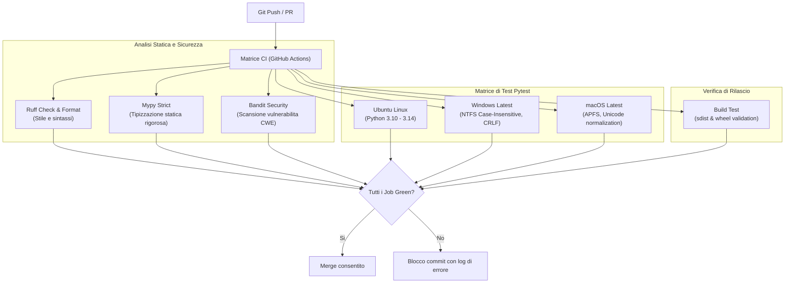

# Architettura della Test Suite e Qualità del Codice

La suite di test di `second-brain-keeper` (collocata in `tests/`) è concepita per garantire che nessuna operazione di manutenzione, rifattorizzazione o normalizzazione possa mai corrompere l'integrità del Second Brain.

L'intera infrastruttura di test rispetta tre invarianti fondamentali:
1. **Zero Effetti Collaterali (Isolamento Ermetico)**: Nessun test tocca o legge mai il Vault reale in `/srv/storage/Vault`. Tutte le esecuzioni avvengono all'interno di ambienti temporanei effimeri generati al volo da fixture pytest.
2. **Determinismo e Velocità**: Tutti i 184 test vengono eseguiti in meno di 0.8 secondi su Linux, consentendo feedback immediato prima di ogni commit.
3. **Copertura Rigorosa ($\ge 90\%$)**: Qualsiasi modulo nuovo o modificato deve superare la soglia minima del 90% di copertura di codice, verificata tramite `pytest-cov`.

---

## 1. Pipeline di Continuous Integration (CI)

Ogni push e pull request viene validato su una matrice multi-piattaforma orchestrata da GitHub Actions (`.github/workflows/ci.yml`):



---

## 2. Metriche di Qualità e Copertura

I controlli eseguiti localmente e in CI impongono standard industriali rigorosi:

| Strumento | Ambito di Controllo | Requisito / Soglia | Esito Attuale |
| :--- | :--- | :--- | :---: |
| **Pytest + Coverage** | Esecuzione test unitari e di integrazione | Copertura $\ge 90\%$ | **184/184 passati (90%)** |
| **Mypy** | Controllo statico dei tipi in modalità strict | 0 errori di tipo | **0 errori su tutti i file sorgente** |
| **Ruff Check** | Analisi statica del codice (Flake8, Pyflakes, Bugbear) | 0 warning | **0 violazioni** |
| **Ruff Format** | Formattazione deterministica del codice (Black-compatible) | 100% conforme | **100% formattato** |
| **Bandit** | Rilevamento vulnerabilità di sicurezza (CWE, unsafe tempfiles) | 0 problemi rilevati | **0 vulnerabilità** |

---

## 3. Design delle Fixture Pytest (`tests/conftest.py`)

La gestione degli ambienti di test simula l'esatta conformità dell'albero decimale di un Second Brain Obsidian:

### `temp_vault`
- Genera una directory temporanea isolata con `tempfile.TemporaryDirectory`.
- Risolve il percorso con `Path.resolve()` per prevenire discrepanze di percorsi abbreviati su Windows (`RUNNER~1` vs `runneradmin`).
- Costruisce la struttura standard Johnny.Decimal:
  - `00-09_Meta/02_Template/` con template ufficiali (`Template_Appunto.md`, `Template_Progetto.md`, `Template_Contatto.md`).
  - `00_Tassonomia_Tag.md` con sezioni semantiche e tag registrati.
  - Note di test nelle cartelle `10-19_Progetti/`, `20-29_Istruzione/`, `30-39_Carriera/32_CRM/`.
  - Cartelle allegati dedicate (`_attachments/`) con immagini e documenti simulati.
  - File MOC `00_Indice.md` pre-compilati per verificare gli algoritmi di aggiornamento incrementale.
- Al termine dell'esecuzione, la teardown pulisce l'ambiente gestendo eventuali file lock su Windows (`ignore_cleanup_errors=True`).

### `temp_archive`
- Simula il Cold Storage speculare `/srv/storage/Archive` per testare le funzioni di archiviazione (`sbk archive`) e scarico di file pesanti (`sbk offload`).

---

## 4. Catalogo Modulare dei File di Test

I **184 test** sono ripartiti in 21 moduli tematici:

### A. Modelli, Configurazione e Utilità
- `tests/test_config.py` (10 test): Caricamento di `vault.toml`, valori predefiniti, upward root discovery, validazione fuori vault, serializzazione dei modelli.
- `tests/test_helpers.py` (5 test): Funzioni ausiliarie (`format_bytes`, `truncate_text`, `compute_file_hash`, `is_ignored_path`, `resolve_vault_path`).
- `tests/test_formatters.py` (4 test): Formattazione tabelle, serializzazione multi-formato (MD, JSON, YAML, CSV), `ReportWriter`.

### B. Core Computazionale e Documenti
- `tests/test_document.py` (6 test): Manipolazione di `MarkdownDocument`, preservazione dei ritorni a capo (CRLF/LF), sostituzione selettiva di wikilink, mutazione tag.
- `tests/test_frontmatter.py` (8 test): Parsing YAML conforme ad Obsidian, protezione delle direttive C (`#include`) e dei colori esadecimali (`#FFFFFF`) dall'estrazione di falsi tag.
- `tests/test_naming.py` (10 test): Normalizzazione `Title_Case`, rimozione caratteri illegali, protezione di acronimi e prefissi numerici, rinomina atomica con aggiornamento MOC.
- `tests/test_links.py` (5 test): Risoluzione wikilink secondo Obsidian, scansione di link rotti e collisioni di stem omonimi.
- `tests/test_attachments.py` (5 test): Rilevamento allegati orfani, file pesanti (>50MB), cancellazione reversibile (soft-delete in `.trash/`) ed eliminazione definitiva.
- `tests/test_indices.py` (3 test): Generazione dei file MOC `00_Indice.md`, raggruppamento per tipologia di nota, abstract da callout e frontmatter.

### C. Motore Transazionale, Undo e Redo
- `tests/test_journal.py` (15 test): Creazione e salvataggio compresso delle transazioni (`.json.gz`), inversione LIFO delle micro-azioni, auto-rollback in-memory su eccezione, rilevamento conflitti SHA-256, pruning automatico e motore `redo`.

### D. Ciclo di Vita Avanzato, Operazioni Batch e Creazione Note
- `tests/test_lifecycle.py` (15 test): Rinomina con propagazione globale dei backlink, spostamenti tra cartelle decimali con doppio update dei MOC, archiviazione a freddo con schede tombstone, offload di allegati pesanti.
- `tests/test_templates.py` (11 test): Risoluzione dei template per tipologia, rendering di variabili dinamiche, staging in `00_Inbox` o cartella esplicita, preflight checks anti-collisione.
- `tests/test_batch.py` (13 test): Operazioni batch atomiche da mapping JSON (`move`, `rename`, `set-type`, `add-tags`) con validazione Strict All-or-Nothing e rollback unico.

### E. Tassonomia, Diagnostica e Telemetria
- `tests/test_taxonomy.py` (6 test): Caricamento tassonomia, validazione tag, inserimento alfabetico ordinato, rimozione sicura.
- `tests/test_audit.py` (6 test): Diagnostica integrata in 5 fasi, calcolo Health Score (0.0 - 100.0), supporto a `--target` circoscritto, penalità e warning di fase.
- `tests/test_search.py` (3 test): Ricerca combinata per query testuale, tag, tipo, cartella e backlink, estrazione di snippet.
- `tests/test_graph.py` (2 test): Diagnostica topologica del grafo concettuale (hubs, dead-ends, orfani).
- `tests/test_map.py` (2 test): Telemetria delle aree Johnny.Decimal e rendering mappa in Markdown.
- `tests/test_vault.py` (6 test): Verifica dell'API Facade ad alto livello `Vault`.
- `tests/test_sandbox.py` (3 test): Inizializzazione isolata della sandbox, reset a stato iniziale e comandi CLI dedicati.
- `tests/test_e2e_vault.py` (1 test): Test end-to-end dell'intero ciclo di vita e bonifica del vault.

### F. Presentation Layer CLI End-to-End
- `tests/test_cli.py` (12 test): Test dei comandi base (`init`, `audit`, `clean-attachments`, `normalize-names`, `generate-indices`, `frontmatter`, logging su file, blocco fuori vault).
- `tests/test_cli_create.py` (5 test): Creazione via CLI con template, staging inbox, rollback atomico con `sbk undo`, simulazione `--dry-run`, export.
- `tests/test_cli_history_undo.py` (9 test): Workflow CLI di mutazione, cronologia, `sbk undo`, `sbk redo`, conflitti e formattazione.
- `tests/test_cli_lifecycle.py` (8 test): Esecuzione CLI di `rename`, `move`, `archive`, `offload` con verifica del rollback.
- `tests/test_cli_milestone3.py` (6 test): Esecuzione CLI di `tags`, `config`, `search`, `graph-health`, `map` e validazione codici di uscita `ExitCode`.

---

## 5. Esecuzione dei Test e Strumenti di Sviluppo

Per eseguire l'intera suite di test e le verifiche di qualità in locale:

```bash
# Esecuzione completa dei 184 test con report di copertura del codice
.venv/bin/pytest --cov=sbk --cov-report=term-missing

# Esecuzione rapida senza coverage
.venv/bin/pytest

# Controllo statico dei tipi con Mypy
.venv/bin/mypy src/ tests/

# Controllo di stile e linting con Ruff
.venv/bin/ruff check src/ tests/

# Verifica di formattazione
.venv/bin/ruff format --check src/ tests/

# Scansione di sicurezza per vulnerabilità CWE con Bandit
.venv/bin/bandit -r src/ -ll
```
